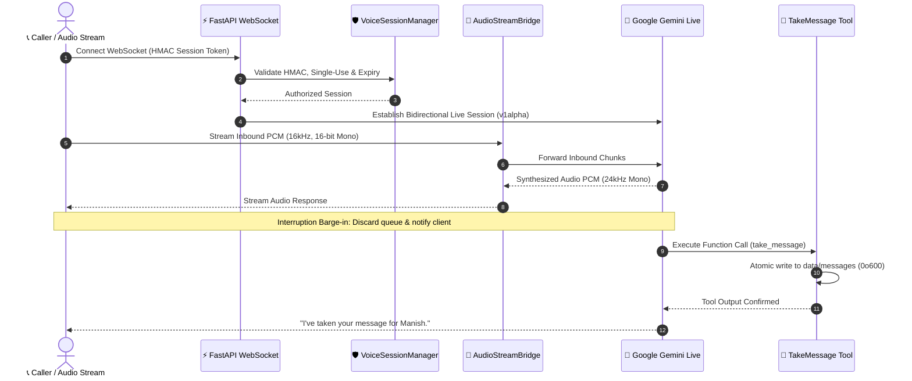

# CallMate AI — Personal Voice Receptionist

[](https://github.com/manishvarma2972-stack/CallMate-AI/actions/workflows/ci.yml)
[](https://www.python.org/)
[](https://fastapi.tiangolo.com/)
[](https://ai.google.dev/)
[](tests/)
[](LICENSE)
[](https://render.com)

CallMate AI is a production-quality personal voice receptionist designed to receive incoming telephone calls, converse naturally with callers in English and Telugu using Google Gemini Live, screen inquiries, take caller messages, and integrate into cloud environments.

---

## 🏗️ Architecture & Phased Roadmap



- **Phase 1: Backend Foundation (Complete)**: FastAPI core, structured logging, Pydantic Settings, real-time health telemetry, standardized error handling, Dockerization.
- **Phase 2: Gemini Live Voice Engine (Complete)**: Bilingual English & Telugu voice engine using `gemini-3.8-live` and `google-genai==3.3.0`, transport-agnostic `AudioStreamBridge`, session authentication with HMAC-SHA256 tokens, race-free single-use replay protection, VAD barge-in interruption handling, collision-safe atomic message persistence, and non-blocking blocking-mode tool execution.
- **Phase 3: Telephony Integration (Upcoming)**: Exotel / Jio call forwarding, SIP trunking, bi-directional media stream adapter bridging to `AudioStreamBridge`.
- **Phase 4: Cloud & Production Hardening (Upcoming)**: PostgreSQL migration, Redis-based distributed session locks & rate limiting, Google Calendar integration, SMS/WhatsApp owner alerts.

---

## Directory Structure

```text
CallMate-AI/
├── .dockerignore              # Docker build context exclusions
├── .env.example               # Configuration template
├── .gitignore                 # Python, test, OS, and secret ignores
├── Dockerfile                 # Hardened python:3.12-slim non-root container (UID 10001)
├── README.md                  # System architecture, commands, and operational guide
├── pyproject.toml             # Packaging metadata and pytest configuration
├── requirements.txt           # Pinned production dependencies
├── requirements-dev.txt       # Pinned development & testing dependencies
├── app/                       # Core application package
│   ├── main.py                # FastAPI initialization, CORS, and route mounting
│   ├── api/
│   │   ├── __init__.py
│   │   └── v1/
│   │       ├── router.py      # Aggregates V1 modular endpoints
│   │       └── endpoints/
│   │           ├── health.py  # Health diagnostics route controller
│   │           └── voice.py   # Authenticated session provisioning & WebSocket streaming
│   ├── core/
│   │   ├── config.py          # Pydantic Settings (gemini-3.8-live, owner persona, auth keys)
│   │   ├── errors.py          # Standardized exception hierarchy and error envelopes
│   │   ├── logging.py         # Structured JSON & console loggers with request correlation
│   │   └── middleware.py      # Request correlation ID & latency telemetry middleware
│   ├── engine/                # Core Gemini Live Engine (Transport-Independent)
│   │   ├── __init__.py
│   │   ├── audio.py           # Linear PCM stream validation, 20ms chunking (640B)
│   │   ├── bridge.py          # AudioStreamBridge (inbound/outbound queues & buffer flushing)
│   │   ├── gemini_live.py     # google-genai Live session manager (client.aio.live)
│   │   ├── prompts.py         # Bilingual Telugu/English receptionist instructions
│   │   └── tools/             # Voice function calling pipeline
│   │       ├── __init__.py    # ToolDispatcher aggregating function declarations
│   │       ├── base.py        # Abstract BaseVoiceTool definition
│   │       └── message_taker.py # Verified take_message tool linked to MessageRepository
│   ├── repositories/          # Persistence Layer
│   │   ├── __init__.py
│   │   └── message_repo.py    # Atomic, collision-safe file storage (Development only)
│   ├── schemas/               # Pydantic request/response models
│   │   ├── common.py          # Standardized error response envelope
│   │   ├── health.py          # Real-time health diagnostic models
│   │   └── voice.py           # Voice session models and TakeMessageSchema
│   └── services/              # Domain services
│       ├── health.py          # Real process telemetry service
│       └── session.py         # VoiceSessionManager (HMAC tokens, lock, TTL, rate limit)
├── data/
│   └── messages/              # Development message storage directory (Docker volume mount)
├── scripts/
│   └── verify_live_voice.py   # Independent live Gemini 3.8 Live API verification script
└── tests/                     # Automated test suite (36 tests)
    ├── conftest.py            # Pytest fixtures and mock test clients
    ├── test_audio_pipeline.py # Unit tests: PCM validation and 20ms framing
    ├── test_config.py         # Unit tests: Configuration loading and validation
    ├── test_errors.py         # Unit tests: Standardized error envelopes
    ├── test_gemini_event_processor.py # Unit tests: Multimodal event parsing & tool responses
    ├── test_health.py         # Integration tests: Real health metrics (RSS, uptime)
    ├── test_interruption_flow.py # Unit tests: Outbound buffer flushing upon barge-in
    ├── test_lifecycle.py      # Unit tests: Lifespan management and OpenAPI docs
    ├── test_message_persistence.py # Unit tests: Atomic file creation, permissions (0600)
    ├── test_session_manager.py # Unit tests: Session lifecycle and TTL expiration
    ├── test_voice_security.py # Integration tests: Owner auth, HMAC tokens, rate limits
    └── test_voice_stream_e2e.py # End-to-end WebSocket connection and audio exchange tests
```

---

## Dependencies & Verified Versions

```text
fastapi>=0.115.0,<1.0.0          # ASGI async web framework
pydantic>=2.9.0,<3.0.0            # Schema validation and data modeling
pydantic-settings>=2.5.0,<3.0.0   # Environment configuration
uvicorn[standard]>=0.30.0,<1.0.0  # Production ASGI server
python-dotenv>=1.0.0,<2.0.0       # Dotenv file loader
google-genai==3.3.0               # Official Google GenAI SDK (Gemini 3.8 Live API)
websockets>=13.0.0,<18.0.0        # High-performance async WebSocket support
pytest>=8.0.0,<10.0.0             # Automated testing framework
pytest-asyncio>=0.24.0,<2.0.0     # Async test execution support for pytest
httpx>=0.27.0,<1.0.0              # Async HTTP client for tests
```

---

## Environment Configuration

Configure the following environment variables in `.env` or in your deployment environment:

| Variable | Description | Required | Default |
| :--- | :--- | :--- | :--- |
| `OWNER_API_KEY` | Secret key required to provision voice sessions | **Yes** | `None` |
| `RECEPTIONIST_OWNER_NAME` | Display name of the owner (sessions fail if unset) | **Yes** | `None` |
| `GEMINI_API_KEY` | Google Gemini API key for Live bidirectional streaming | **Yes** | `None` |
| `SECRET_KEY` | 32-byte secret for cryptographic HMAC session token signing | **Yes** | Dev fallback |
| `RECEPTIONIST_NAME` | Name of the AI receptionist | No | `CallMate` |
| `GEMINI_MODEL` | Gemini Live model ID | No | `gemini-3.8-live` |
| `GEMINI_VOICE_NAME` | Prebuilt voice persona (`Aoede`, `Kore`, `Puck`, `Charon`, `Fenrir`) | No | `Aoede` |
| `GEMINI_TEMPERATURE` | Generation randomness | No | `0.6` |
| `MAX_ACTIVE_VOICE_SESSIONS` | Maximum concurrent voice sessions permitted | No | `25` |
| `SESSION_TOKEN_TTL_SECONDS` | Lifetime of session tokens in seconds | No | `300` (5 min) |
| `SESSION_RATE_LIMIT_PER_MINUTE` | Max session creation calls per minute per client | No | `10` |
| `MESSAGE_STORAGE_PATH` | Development file storage directory | No | `data/messages` |

---

## Running the Application Locally

### 1. Setup Virtual Environment
```bash
python3 -m venv .venv
source .venv/bin/activate
pip install -r requirements-dev.txt
cp .env.example .env
# Edit .env and set OWNER_API_KEY, RECEPTIONIST_OWNER_NAME, GEMINI_API_KEY, and SECRET_KEY
```

### 2. Run the Development Server
```bash
uvicorn app.main:app --host 0.0.0.0 --port 8000 --reload
```

### 3. Run Automated Tests
```bash
pytest -v
```

### 4. Run via Docker
```bash
# Build Docker image
docker build -t callmate-ai:latest .

# Run container with persistent messages volume
docker run -d --name callmate-backend \
  -p 8000:8000 \
  -e OWNER_API_KEY="my-owner-secret-key" \
  -e RECEPTIONIST_OWNER_NAME="Your Name" \
  -e GEMINI_API_KEY="your-gemini-api-key" \
  -e SECRET_KEY="your-32-byte-hex-secret-key" \
  -v callmate_messages:/app/data/messages \
  callmate-ai:latest
```

---

## Voice Engine Flow & API Usage

### Step 1: Provision an Authenticated Voice Session
```bash
curl -X POST http://localhost:8000/api/v1/voice/sessions \
  -H "X-API-Key: my-owner-secret-key" \
  -H "Content-Type: application/json" \
  -d '{"language_hint": "en"}'
```
Response:
```json
{
  "session_id": "93c126f4-7fea-43ed-a854-470ebe7c6388",
  "token": "93c126f4-7fea-43ed-a854-470ebe7c6388.1731748200.7f12a.8b90c...",
  "expires_at": 1731748200,
  "ws_url": "/api/v1/voice/stream/93c126f4-7fea-43ed-a854-470ebe7c6388",
  "owner_name": "Your Name",
  "receptionist_name": "CallMate"
}
```

### Step 2: Connect via WebSocket & Stream Audio
Connect to:
```text
ws://localhost:8000/api/v1/voice/stream/{session_id}?token={token}
```
- Inbound: Stream raw 16,000 Hz, 16-bit Mono Linear PCM audio bytes as binary frames.
- Outbound: Receive synthesized 24,000 Hz, 16-bit Mono Linear PCM audio bytes as binary frames.
- Interruption: On caller barge-in, the server flushes outbound audio buffers and sends a control event:
  `{"type": "control", "event": "interrupted", "action": "flush_buffer"}`.
- Function Calling: The `take_message` tool persists caller messages atomically to `/app/data/messages/` with restricted permissions (`0o600`) and structured output.

---

## Deploy to Render

Deploy CallMate AI instantly to Render using the Blueprint button or manual configuration:

[](https://render.com/deploy?repo=https://github.com/manishvarma2972-stack/CallMate-AI)

### Option A: Render Blueprint (Recommended)
1. Open [Render Dashboard](https://dashboard.render.com).
2. Click **New +** &rarr; **Blueprint**.
3. Connect your repository: `manishvarma2972-stack/CallMate-AI`.
4. Render automatically detects `render.yaml`:
   - Configures Python 3.12 environment, dependencies, and dynamic `$PORT` routing.
   - Generates cryptographically secure values for `SECRET_KEY` and `OWNER_API_KEY`.
5. Enter your `GEMINI_API_KEY` when prompted and click **Apply**.

### Option B: Manual Web Service
1. In Render, select **New +** &rarr; **Web Service**.
2. Connect `https://github.com/manishvarma2972-stack/CallMate-AI`.
3. Set the build and runtime settings:
   - **Runtime**: Python 3
   - **Build Command**: `pip install -r requirements.txt`
   - **Start Command**: `uvicorn app.main:app --host 0.0.0.0 --port $PORT`
   - **Health Check Path**: `/health`
4. Configure required Environment Variables in Render:
   - `RECEPTIONIST_OWNER_NAME`: `Manish Varma`
   - `GEMINI_API_KEY`: `<Your Gemini API Key>`
   - `SECRET_KEY`: `<Generated 32-byte secret>`
   - `OWNER_API_KEY`: `<Secure Owner API key>`
   - `GEMINI_MODEL`: `gemini-3.8-live`
   - `GEMINI_API_VERSION`: `v1alpha`
   - `GEMINI_VOICE_NAME`: `Aoede`
5. Click **Create Web Service**.

